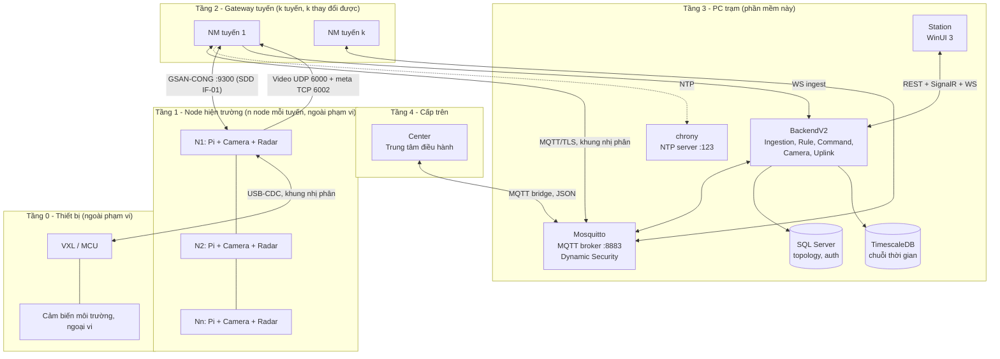
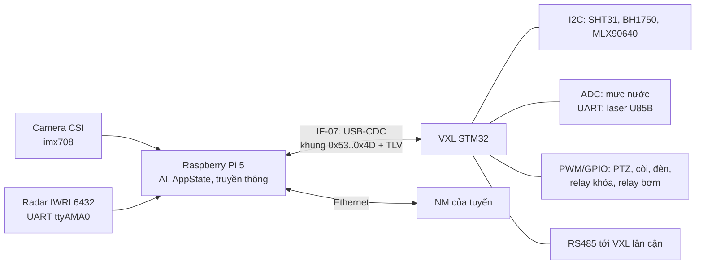
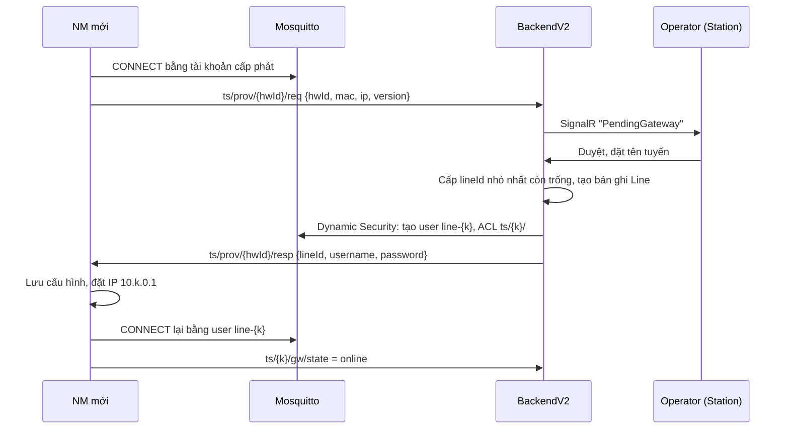
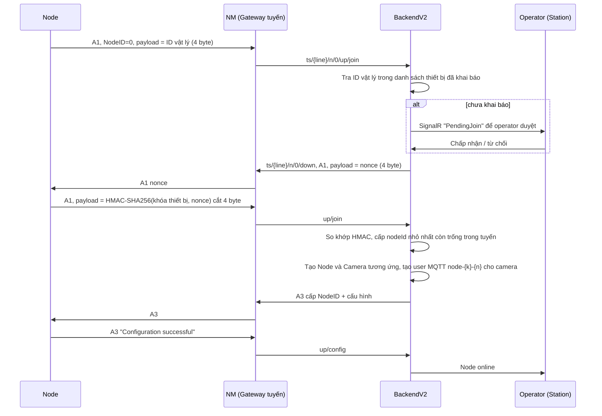
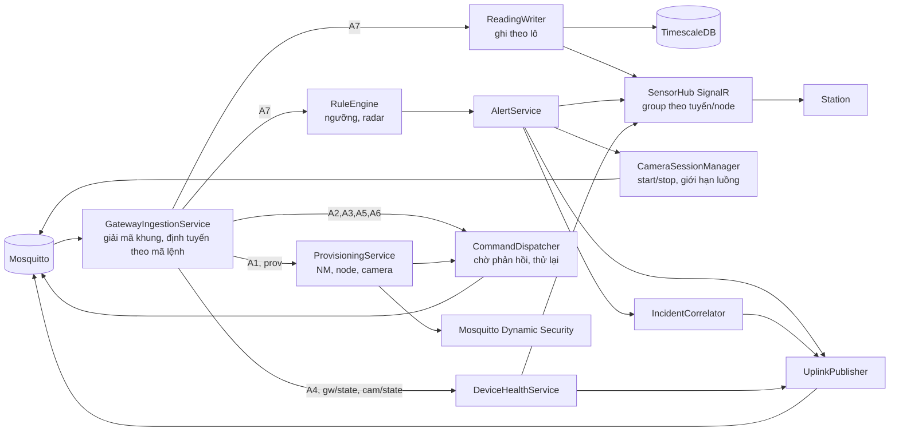

# Kiến trúc và giao thức hệ thống Tunnel Security trên mạng LAN

Tài liệu này chuẩn hóa sơ đồ phác thảo `kien-truc.jpeg` thành kiến trúc và giao thức cho phần mềm PC.
Phạm vi là phía PC (BackendV2 + Station) và hợp đồng giao tiếp với các node.
Firmware/phần mềm trên node (Raspberry Pi) và vi xử lý chưa có trong repo nên chỉ mô tả ở mức giao diện, không thiết kế chi tiết.

Hai ràng buộc thiết kế xuyên suốt:
- Số lượng NM (tuyến) và số node trong mỗi tuyến không cố định, phải thêm/bớt được khi hệ thống đang chạy mà không sửa code hay file cấu hình của PC.
- Mỗi node đều có camera riêng.

---

## 1. Đọc sơ đồ phác thảo

Ảnh chỉ là minh họa, số lượng NM và node trong ảnh không phải giới hạn.

| Ký hiệu trong ảnh | Ý nghĩa | Thực thể |
|---|---|---|
| PC | Máy tính trung tâm của trạm | Phần mềm này: BackendV2 + Station + CSDL + MQTT broker |
| LAN | Đường trục Ethernet nối PC với các tuyến | Switch lõi tại trạm |
| NM1..NMk | Node Master, đầu mỗi tuyến, số lượng tùy ý | Raspberry Pi đóng vai trò Gateway của tuyến |
| SW | Switch trên tuyến, nối chuỗi (daisy chain) | Switch công nghiệp tại mỗi điểm đặt node |
| N1..Nn | Node hiện trường, số lượng tùy ý trong mỗi tuyến | Raspberry Pi + camera + radar + VXL |
| N (GW) | Node cuối tuyến | Giống các node khác, thêm vai trò cổng ra cho thiết bị phụ nếu có |
| VXL | Vi xử lý đi kèm mỗi node | MCU (STM32) đọc các cảm biến còn lại, điều khiển ngoại vi, nối Pi qua USB |
| RS485 | Bus nối các VXL trong tuyến | Đường truyền dự phòng khi Ethernet của một node bị đứt |
| SS | Cảm biến nối VXL | Ánh sáng, mực nước, nhiệt ẩm, camera nhiệt, khoảng cách laser |
| Camera, Radar | Có ở mọi node | Hai thiết bị duy nhất nối trực tiếp Pi: camera CSI, radar mmWave qua UART |
| PC Uplink: An toàn / Cảnh báo / Tình huống | Ba loại bản tin PC báo lên cấp trên | Gửi lên ứng dụng Center |

---

## 2. Kiến trúc phân tầng



### 2.1 Vai trò từng tầng

| Tầng | Thành phần | Trách nhiệm |
|---|---|---|
| 0 | VXL + cảm biến | Đo ánh sáng, mực nước, nhiệt ẩm, camera nhiệt, laser; điều khiển còi/đèn/khóa/bơm/PTZ; liên kết RS485 với VXL lân cận |
| 1 | Node (Pi) | Đọc radar và camera, gom TLV từ VXL, đóng khung, gửi lên NM, nhận lệnh và chuyển lệnh ngoại vi xuống VXL, phát camera khi được yêu cầu, ghi đệm video vòng tại chỗ |
| 2 | NM (Pi Gateway) | Quản lý node trong tuyến (join, keep-alive A4, đồng bộ giờ), chuyển tiếp khung lên PC, đệm dữ liệu khi PC mất kết nối |
| 3 | PC | Lưu trữ, đánh giá ngưỡng, sinh cảnh báo, ghép tình huống, điều khiển, xem camera, hiển thị, báo cáo lên Center |
| 4 | Center | Giám sát tổng hợp nhiều trạm |

### 2.2 Quyết định thiết kế chính

1. **Tuyến (NM) là đơn vị mở rộng.**
   Muốn tăng quy mô thì thêm NM và tuyến mới, không cần đổi gì ở các tuyến cũ.
   Node ID chỉ có 1 byte (1..254) nên một tuyến chứa tối đa 254 node; vượt mức đó thì tách thành tuyến mới.
   Định danh toàn cục của node là cặp `(lineId, nodeId)`.
2. **PC không biết trước có bao nhiêu NM và node.**
   NM và node tự đăng ký vào hệ thống (mục 4.4 và 4.5), operator duyệt trên Station.
   Code và cấu hình PC không chứa danh sách tuyến hay node cố định.
3. **MQTT là giao thức vận chuyển giữa NM và PC.**
   Broker đặt trên PC, mỗi NM là một MQTT client.
   MQTT cho sẵn: tự kết nối lại, QoS, Last Will (phát hiện mất kết nối), retained message (trạng thái hiện tại), phân quyền theo topic.
   Wildcard `+` trong topic giúp PC nhận dữ liệu của tuyến mới mà không phải subscribe thêm.
4. **Payload giữa NM và PC giữ nguyên khung nhị phân `0x53 ... 0x4D`.**
   NM chuyển tiếp trong suốt, không dịch sang JSON.
   Cùng một codec `WireProtocol` dùng được cho cả USB-CDC (VXL - node), TCP (node - NM) và MQTT (NM - PC).
5. **Camera chỉ phát khi có người xem hoặc khi có sự kiện** (mục 5).
   Vì mọi node đều có camera, nếu tất cả cùng phát liên tục thì băng thông tuyến và PC sẽ là điểm nghẽn đầu tiên khi mở rộng.
6. **Uplink lên Center dùng JSON**, vì đây là kênh giữa hai phần mềm, không bị giới hạn tài nguyên như thiết bị nhúng.
7. **Giờ chuẩn của toàn hệ thống lấy từ PC** (chrony làm NTP server trên LAN).
   NM và node đồng bộ NTP với PC, NM phát thêm lệnh A4 xuống node như tài liệu giao thức yêu cầu.

### 2.3 Cấu trúc bên trong một node

Chi tiết phần cứng nằm trong SDD `AIOT-NODE-SDD-001` v1.2 (`Cảm biến và các kết nối.docx`), mục 3 và 4.6.



- Pi chỉ nối trực tiếp camera và radar, không dùng I2C/GPIO cho cảm biến hay ngoại vi.
- VXL gửi số đo lên Pi bằng A7 với đúng TLV như tầng trên (`0x01..0x03`, `0x14`); Pi ghép nguyên trạng với TLV radar (`0x04`) rồi gửi lên NM.
  Vì vậy PC không phân biệt dữ liệu đến từ Pi hay VXL, BackendV2 không phải sửa phần giải mã.
- Lệnh A6 từ PC: Pi tự xử lý chế độ nguồn, chuyển TLV ngoại vi `0x80..0x84` xuống VXL và chỉ báo xác nhận lên khi VXL đã xác nhận.
- Pi gửi A4 xuống VXL mỗi 1 giây; mất phản hồi 3 giây thì Pi bật bit lỗi cảm biến (bit 0 mã lỗi A4) để PC thấy.
- Mã `0x84` (PTZ) và `0x14` (nhiệt độ cực đại camera nhiệt) chưa có trong "Cấu trúc khung truyền" và `WireProtocol`, sẽ bổ sung theo kế hoạch `docs/plans/2026-10-22-vxl-node-redesign.md`.

---

## 3. Quy hoạch mạng LAN

Mỗi tuyến một dải `/16` riêng, nên số tuyến và số node tăng mà không phải đánh lại địa chỉ.

| Thành phần | Địa chỉ (IP tĩnh) | Ví dụ |
|---|---|---|
| PC trạm, switch lõi | `10.0.0.0/16` | PC = `10.0.0.10` |
| NM tuyến k (k = 1..254) | `10.k.0.1` | NM tuyến 3 = `10.3.0.1` |
| Pi của node n tuyến k (n = 1..254) | `10.k.1.n` | N7 tuyến 3 = `10.3.1.7` |
| Camera IP của node n (nếu dùng camera rời) | `10.k.2.n` | `10.3.2.7` |
| Dự phòng cho thiết bị khác của tuyến | `10.k.3.0` trở đi | |

Địa chỉ suy ra trực tiếp từ `(lineId, nodeId)`, không cần bảng tra.
Mỗi tuyến một VLAN (VLAN ID = 100 + k) để lỗi broadcast của một tuyến không lan sang tuyến khác.

| Cổng trên PC | Giao thức | Dùng cho |
|---|---|---|
| 8883 | MQTT over TLS | NM, camera node và Center bridge (1883 không TLS chỉ dùng khi phát triển) |
| 5080 / 7089 | HTTP / HTTPS | REST, SignalR `/hubs/sensors`, WebSocket camera |
| 123/udp | NTP | Đồng bộ giờ |

---

## 4. Giao thức PC - NM (MQTT)

### 4.1 Cây topic

Tiền tố `ts/{lineId}`, trong đó `lineId` là số tuyến 1..254 do PC cấp khi duyệt NM.

| Topic | Chiều | Mã lệnh | QoS | Retained | Nội dung |
|---|---|---|---|---|---|
| `ts/prov/{hwId}/req` | NM → PC | - | 1 | không | NM mới xin cấp tuyến (mục 4.4) |
| `ts/prov/{hwId}/resp` | PC → NM | - | 1 | không | Kết quả cấp tuyến |
| `ts/{line}/gw/state` | NM → PC | - | 1 | có | `online` / `offline` (Last Will) |
| `ts/{line}/gw/status` | NM → PC | - | 1 | có | Trạng thái NM, JSON nhỏ (uptime, số node, độ đầy bộ đệm, phiên bản) |
| `ts/{line}/n/{nodeId}/up/data` | NM → PC | A7 | 0 | không | Dữ liệu cảm biến |
| `ts/{line}/n/{nodeId}/up/status` | NM → PC | A4 | 1 | có | Phản hồi keep-alive: trạng thái, mã lỗi, ngoại vi |
| `ts/{line}/n/{nodeId}/up/config` | NM → PC | A2, A3 | 1 | không | Cấu hình hiện tại / xác nhận cấu hình |
| `ts/{line}/n/{nodeId}/up/ack` | NM → PC | A5, A6 | 1 | không | Xác nhận reset / điều khiển |
| `ts/{line}/n/0/up/join` | NM → PC | A1 | 1 | không | Node mới xin tham gia (ID vật lý trong payload) |
| `ts/{line}/n/{nodeId}/down` | PC → NM | A1..A6 | 1 | không | Lệnh xuống node, `nodeId = 255` là phát cho toàn tuyến |
| `ts/{line}/n/{nodeId}/cam/ctl` | PC → node | - | 1 | không | Bật/tắt phát camera, JSON (mục 5) |
| `ts/{line}/n/{nodeId}/cam/state` | node → PC | - | 1 | có | Trạng thái camera, JSON (mục 5) |

Topic camera đi thẳng giữa node và broker, không qua NM, vì camera không thuộc giao thức Node-Gateway ("Không chứa dữ liệu Camera").

Lý do chọn QoS:
- Dữ liệu A7 gửi theo chu kỳ, mất một bản không ảnh hưởng vì bản sau tới ngay, nên QoS 0 để giảm tải.
- Trạng thái, cấu hình, lệnh điều khiển phải tới nơi, nên QoS 1.
  Mọi xử lý ở PC phải idempotent vì QoS 1 có thể nhận trùng.

### 4.2 Khung bản tin (không đổi so với tài liệu gốc)

| Byte | Trường | Kiểu | Giá trị |
|---|---|---|---|
| 0 | Start | byte | `0x53` |
| 1 | Mã lệnh | byte | `0xA1`..`0xA7` |
| 2..3 | Độ dài payload | uint16 LE | 0..65535 |
| 4 | Node ID | byte | 0 = chưa cấp, 1..254 = node, 255 = toàn tuyến |
| 5.. | Payload | TLV | |
| n-3..n-2 | CRC | uint16 LE | CRC-16/CCITT-FALSE (đa thức 0x1021, khởi tạo 0xFFFF) của các byte trước nó |
| n-1 | Stop | byte | `0x4D` |

Tài liệu gốc chỉ ghi "checksum 2 byte" mà không nêu thuật toán; `WireProtocol/Crc16.cs` chọn CRC-16/CCITT-FALSE và mọi bên (VXL, node, NM, PC) phải dùng đúng thuật toán này.
SDD của node (`gsan_protocol.py`) lại dùng CRC16-Modbus cho cùng khung; phải thống nhất trước khi viết firmware VXL (SDD VĐ-07).

Payload dùng TLV: Header 2 byte (loại + số thứ tự), Length 2 byte LE, Value.
Header `0x01..0x7F` là cảm biến, `0x80..0xFF` là ngoại vi, theo "Cấu trúc khung truyền".
Số thứ tự trong header cho phép mỗi node gắn tới 255 cảm biến cùng loại, nên số cảm biến trên node cũng mở rộng được.

### 4.3 Bổ sung: TLV thời gian đo (Header `0x00 0x01`)

Vấn đề: hiện PC gán `DateTime.UtcNow` lúc nhận.
Khi PC mất kết nối và NM xả bộ đệm, toàn bộ dữ liệu cũ sẽ bị gán sai giờ.

Bổ sung một TLV siêu dữ liệu, dùng byte loại `0x00` (chưa được gán trong tài liệu gốc):

| Header | Length | Value |
|---|---|---|
| `0x00 0x01` | 8 | Unix time tính bằng mili giây, uint64 LE, giờ UTC |

Quy tắc:
- TLV này là tùy chọn và nếu có thì đứng đầu payload A7.
- PC dùng giờ trong TLV nếu có, nếu không thì dùng giờ nhận.
- Parser cũ gặp `0x00` sẽ bỏ qua như loại không biết, nên tương thích ngược.

### 4.4 Thêm NM mới (cấp tuyến)

NM mới chưa có `lineId` và chưa có tài khoản MQTT riêng.
Nó dùng một tài khoản cấp phát dùng chung, chỉ được quyền publish `ts/prov/{hwId}/req` và subscribe `ts/prov/{hwId}/resp`.



Yêu cầu (`ts/prov/{hwId}/req`, JSON, mọi trường tùy chọn):

```json
{ "mac": "02:51:00:00:00:09", "ip": "10.9.0.1", "version": "1.0.0" }
```

Kết quả (`ts/prov/{hwId}/resp`):

```json
{ "status": "approved", "lineId": 4, "name": "Tuyến Đông", "username": "line-4", "password": "<ngẫu nhiên 24 byte>" }
```

`status` là `approved` hoặc `rejected`; `username`/`password` chỉ có khi bật Dynamic Security.
NM phải kết nối bằng client id đúng bằng `hwId`, vì ACL của tài khoản cấp phát dùng `%c` (client id) để mỗi NM chỉ đọc được kết quả của chính mình.
NM đã có tuyến mà gửi lại yêu cầu (cài lại, mất cấu hình) sẽ được cấp lại đúng tuyến cũ với mật khẩu mới.

Dùng plugin Dynamic Security của Mosquitto để tạo tài khoản và ACL lúc đang chạy, không phải sửa file cấu hình và khởi động lại broker.
Mosquitto ngắt kết nối một client ngay khi role của nó thay đổi, nên BackendV2 chỉ gán role khi còn thiếu.
Gỡ một tuyến là thao tác ngược lại: xóa user trên broker, đánh dấu `Line` là đã gỡ, giữ dữ liệu lịch sử.

### 4.5 Thêm node mới (A1, xác thực thách đố)



Khóa thiết bị là khóa bí mật riêng từng ID vật lý, nạp khi sản xuất và lưu trên PC (không truyền qua mạng).
Vì mọi node đều có camera, việc duyệt node tự động tạo luôn bản ghi camera, operator không phải khai báo riêng.
Thông tin đăng nhập camera (user MQTT, token WS) được gửi kèm trong cấu hình A3.

### 4.6 Lệnh xuống và xác nhận

- PC gửi lệnh vào `ts/{line}/n/{nodeId}/down`.
- Mỗi node chỉ có tối đa một lệnh đang chờ cho mỗi mã lệnh, vì khung không có mã giao dịch.
- Chờ phản hồi cùng mã lệnh trên `up/ack` hoặc `up/config` trong 3 giây, thử lại tối đa 3 lần, sau đó đánh dấu lệnh thất bại và báo operator.
- Lệnh A5/A6 với `nodeId = 255` không chờ phản hồi từng node mà kiểm tra lại bằng chu kỳ A4 kế tiếp.
- Bảng lệnh đang chờ khóa theo `(lineId, nodeId, mã lệnh)`, độc lập giữa các tuyến nên không bị nghẽn khi số tuyến tăng.

### 4.7 Giám sát sống/chết

| Đối tượng | Cơ chế | Ngưỡng offline |
|---|---|---|
| NM | MQTT Last Will trên `gw/state` | Ngay khi broker phát hiện mất kết nối (keep-alive MQTT 15 giây) |
| Node | NM phát A4 mỗi 10 giây, node trả A4 lên `up/status` | Không có A4 trong 3 chu kỳ (30 giây) |
| Camera | Last Will trên `cam/state` | Ngay khi broker phát hiện mất kết nối |

Khi NM offline, PC đánh dấu toàn bộ node thuộc tuyến là "không xác định" thay vì "offline", vì node có thể vẫn chạy.
Nếu camera của node đó vẫn online, operator vẫn xem được hình, đây là cách xác nhận node còn sống.

PC kiểm tra hết hạn bằng một hàng đợi theo thời điểm hết hạn, không quét toàn bộ danh sách node mỗi chu kỳ, nên chi phí không tăng theo số node.

### 4.8 Đường dự phòng RS485

Khi Ethernet của một node bị đứt, VXL của node đó chuyển khung qua bus RS485 tới VXL lân cận, node lân cận chuyển tiếp lên NM.
Vì khung mang sẵn Node ID gốc, việc chuyển tiếp là trong suốt với PC, PC không cần xử lý gì thêm.
Camera của node đó sẽ mất hình vì RS485 không đủ băng thông, PC hiển thị camera là offline.
Radar nối vào Pi chứ không nối VXL, nên muốn giữ dữ liệu radar trên đường dự phòng thì Pi phải đẩy khung A7 đã đóng gói xuống VXL qua USB để VXL chuyển tiếp; phần này còn mở (SDD VĐ-09).
Chi tiết thực hiện thuộc phía node, nằm ngoài phạm vi tài liệu này.

### 4.9 Bảo mật

- MQTT dùng TLS trên cổng 8883.
- Mỗi NM có một user `line-{k}` chỉ được publish `ts/k/gw/#`, `ts/k/n/+/up/#` và subscribe `ts/k/n/+/down`.
- Mỗi camera node có một user `node-{k}-{n}` chỉ được dùng `ts/k/n/{n}/cam/#`.
- Một thiết bị bị chiếm quyền không thể giả mạo dữ liệu của tuyến hay node khác.
- Mục "mã hóa E2EE" trong tài liệu gốc được đáp ứng ở chặng LAN bằng TLS, xác thực thiết bị bằng HMAC ở A1.
- ACL mặc định của broker là từ chối publish/subscribe; BackendV2 kiểm tra và sửa lại mỗi lần khởi động.
- Tài khoản cấp phát dùng chung cho mọi NM, nên yêu cầu cấp lại cho tuyến đã có không tự đổi mật khẩu tuyến:
  yêu cầu đó nằm chờ operator duyệt (trừ khi bật `AutoApproveGateways`, chỉ dùng khi phát triển).
- MAC của A1 chỉ 4 byte theo tài liệu gốc, nên một thiết bị xác thực sai 5 lần bị khóa 5 phút.
- Thu hồi khóa thiết bị có hiệu lực ngay: node đang chạy bị tách, dữ liệu của nó bị bỏ, và không tham gia lại được.
- Ngoài môi trường Development, BackendV2 không khởi động nếu mật khẩu MQTT để trống, ngắn hơn 12 ký tự hoặc là giá trị mặc định.
- API thay đổi thiết bị cần quyền theo nhóm chức năng (mục 7): `DEVICE_MANAGEMENT` cho lệnh xuống node,
  `ALERT_EVENT_MANAGEMENT` cho cảnh báo và tình huống, `SYSTEM_ADMINISTRATION` cho duyệt NM, khai báo/thu hồi thiết bị và gỡ tuyến.

### 4.10 Payload của từng lệnh

Tài liệu gốc chỉ ghi payload dạng "Reset node", "ON, OFF, Đèn, còi"; phần dưới là định dạng nhị phân cụ thể đã cài đặt trong `WireProtocol/NodeMessages.cs`.
Mọi số nguyên là little-endian.

| Lệnh | Chiều | Node ID trong khung | Payload |
|---|---|---|---|
| A1 yêu cầu | node → PC | 0 | ID vật lý (4) |
| A1 thách đố | PC → node | 0 | ID vật lý (4), nonce (4) |
| A1 trả lời | node → PC | 0 | ID vật lý (4), MAC (4) = 4 byte đầu HMAC-SHA256(khóa, nonce) |
| A3 cấp ID | PC → node | 0 | ID vật lý (4), Node ID mới (1), TLV cấu hình |
| A3 xác nhận cấp ID | node → PC | 0 | ID vật lý (4), mã kết quả (1) |
| A2 đọc cấu hình | PC → node | n | rỗng |
| A2 cấu hình hiện tại | node → PC | n | TLV cấu hình |
| A3 ghi cấu hình | PC → node | n | TLV cấu hình (chỉ trường cần đổi) |
| A4 trạng thái | node → PC | n | pin (float 4), trạng thái (1: 0 OFF, 1 SLEEP, 2 ON, 3 BUSY), mã lỗi (1, bit), mỗi ngoại vi 2 byte (0xAn đèn / 0xBn còi, 0/1) |
| A5 reset | PC → node | n hoặc 255 | rỗng |
| A6 điều khiển | PC → node | n hoặc 255 | TLV: `0x00 0x02` chế độ nguồn (1 byte), `0x80..0x83 STT` ngoại vi (1 byte 0/1) |
| A3/A5/A6 xác nhận | node → PC | n | mã kết quả (1: 0 OK, 1 từ chối, 2 payload sai, 3 bận, 4 lỗi) |

TLV cấu hình dùng loại `0x00`: `0x10` Node ID (1), `0x11` chu kỳ lấy mẫu ms (uint32), `0x12` loại node (1), `0x13` địa chỉ IPv4 (4).
Mã lỗi A4 theo bit: 0 cảm biến, 1 ngoại vi, 2 pin yếu, 3 bộ nhớ, 4 RS485, 5 chưa đồng bộ giờ.
Khóa thiết bị có thể dẫn xuất hàng loạt khi sản xuất: khóa = HMAC-SHA256(khóa gốc, ID vật lý), mỗi thiết bị vẫn một khóa khác nhau.
Theo SDD 4.2.3; khóa riêng từng thiết bị nên MAC vẫn gắn với ID vật lý.

### 4.11 Chặng node - NM

Node nói giao thức GSAN-CONG của SDD (IF-01) với NM qua TCP cổng 9300.
Khung giống khung NM - PC nhưng CRC là CRC16-Modbus tính trên [cmd..payload] (đúng SDD); chặng NM - PC giữ CRC CCITT-FALSE tính trên [Start..payload], NM đóng khung lại khi chuyển tiếp.
Mã triển khai: `LineGateway/Gsan/` (phía NM), `NodeAgent/gsan_*.py` (phía node), `WireProtocol/` (khung, payload, vector kiểm thử dùng chung).

NM không giữ khóa thiết bị: nó dịch bắt tay của node sang bắt tay NM - PC (mục 4.5), PC quyết định.

| Bước | Node → NM | NM ↔ PC | Ghi chú |
|---|---|---|---|
| 1 | A1 yêu cầu (ID vật lý) | A1 yêu cầu lên PC | NM ghi nhớ phiên theo ID vật lý; theo IP nguồn sau khi gắn (bước 5) |
| 2 | NM → node: A1 thách đố (nonce) | PC → NM: A1 thách đố | |
| 3 | A1 trả lời (MAC 4 byte) | A1 trả lời lên PC | Chỉ HMAC-SHA256; không dùng chữ ký Ed25519 vì 64 byte không vừa trường 4 byte |
| 4 | NM → node: A3 cấp Node ID | PC → NM: A3 cấp ID | Payload 1 byte Node ID; Node ID trong khung là ID mới |
| 5 | Node → NM: A3 xác nhận, payload ASCII `OK` | NM báo PC mã kết quả | Khác `OK` thì NM đóng phiên, báo từ chối |
| 6 | A4 trạng thái 7 byte (SDD bảng 5.3) | NM đổi sang A4 của NM - PC | Pi không có pin: pin là NaN, PC coi là không có và không ghi đè `BatteryLevel` |
| 7 | A7 dữ liệu TLV | Chuyển tiếp | NM chèn TLV thời gian nhận (giờ NM, đồng bộ NTP) nếu node chưa gắn |

Lệnh A2 (đọc cấu hình), A5 (reset), A6 (điều khiển ngoại vi) từ PC xuống node chưa hỗ trợ: NM ghi log và bỏ qua (ngoài phạm vi đợt này).
Khung có Node ID khác ID đã cấp cho phiên bị bỏ và ghi log.
Thiếu radar hoặc camera (hai thiết bị bắt buộc) được báo là lỗi cảm biến trong A4.

Mục tiêu radar đi trong A7 dưới dạng TLV radar; NodeAgent chỉ gửi mục tiêu đã xác nhận, tối đa 40 mục tiêu mỗi bản tin, chu kỳ 400 ms.

---

## 5. Giao thức camera (mọi node đều có camera)

> Đã triển khai một phần: camera phát liên tục kèm khung YOLO, đi qua NM (mục 5.4).
> Chế độ Nghỉ / Xem theo yêu cầu, đệm vòng 60 giây, điều khiển `cam/ctl` và giới hạn số luồng (mục 5.2, 5.3) chưa làm.

### 5.1 Vấn đề băng thông

Ước lượng cho một luồng JPEG 640x480, 5 fps, khoảng 50 KB mỗi khung: khoảng 2 Mbps mỗi camera.

| Quy mô | Tất cả cùng phát liên tục | Theo thiết kế này (tối đa 16 xem trực tiếp + sự kiện) |
|---|---|---|
| 1 tuyến, 30 node | 60 Mbps trên một chuỗi switch | Không đáng kể |
| 10 tuyến, 300 node | 600 Mbps vào PC | Khoảng 32 đến 60 Mbps |
| 30 tuyến, 900 node | 1,8 Gbps, vượt card mạng 1 Gbps | Khoảng 32 đến 60 Mbps |

Các switch nối chuỗi trong một tuyến dùng chung đường lên, nên tải dồn về đoạn gần NM nhất.
Vì vậy camera không được phát liên tục mà theo yêu cầu.

### 5.2 Ba chế độ hoạt động

| Chế độ | Khi nào | Node làm gì |
|---|---|---|
| Nghỉ | Mặc định | Không gửi hình, ghi đệm vòng 60 giây gần nhất trong RAM/thẻ nhớ |
| Xem trực tiếp | Có người mở camera trên Station | Mở WS tới PC, gửi JPEG |
| Sự kiện | PC phát hiện cảnh báo tại node này hoặc node lân cận | Gửi đoạn đệm trước sự kiện + phát trực tiếp đến khi tình huống đóng |

Ghi đệm vòng tại node giúp có hình trước thời điểm báo động mà không tốn băng thông khi bình thường.

> Hiện chỉ có một chế độ: node theo SDD phát liên tục khoảng 15 fps (khoảng 6 Mbps mỗi node ở 50 KB/khung, gấp ba ước lượng ở 5.1).
> Chế độ "Nghỉ" và "Xem theo yêu cầu" chưa làm; băng thông tính ở 5.1 là mục tiêu của chế độ theo yêu cầu, chưa đạt.
> NM chỉ giữ 4 bản tin mỗi node trong hàng đợi, đầy thì bỏ bản cũ nhất.

### 5.3 Điều khiển camera

> Chưa triển khai (xem ghi chú ở 5.2): hiện node phát liên tục, không nhận `cam/ctl`.

PC gửi `ts/{line}/n/{nodeId}/cam/ctl`:

```json
{ "action": "start", "reason": "view", "fps": 5, "quality": 70, "preRollSeconds": 0 }
```

| Trường | Giá trị |
|---|---|
| `action` | `start`, `stop` |
| `reason` | `view` (xem trực tiếp), `event` (sự kiện) |
| `fps`, `quality` | Tham số mã hóa, PC hạ xuống khi tải cao |
| `preRollSeconds` | Số giây đệm trước sự kiện cần gửi kèm, 0 khi xem trực tiếp |

Node báo `ts/{line}/n/{nodeId}/cam/state` (retained, Last Will = `offline`):

```json
{ "state": "streaming", "fps": 5, "resolution": "640x480", "bufferSeconds": 60 }
```

`state` nhận một trong `idle`, `streaming`, `error`, `offline`.

### 5.4 Luồng hình

```
Node → UDP 6000 (mảnh JPEG) + TCP 6002 (metadata YOLO) → NM
NM: ghép JPEG, gắn node theo IP nguồn của phiên GSAN đã xác thực
  → WS ingest BackendV2 /ws/camera/{cameraId}/ingest (binary = JPEG, Text = khung YOLO JSON)
  → CameraRelayRegistry
  → /ws/camera/{cameraId}/view → Station
```

- Mảnh video UDP: header 16 byte (seq uint32, timestamp double, chỉ số mảnh uint16, tổng số mảnh uint16, little-endian) + tối đa 1.400 byte dữ liệu, tối đa 512 mảnh mỗi JPEG.
  Chỉ giữ một frame đang ghép: mảnh của frame mới hơn bỏ frame dở, mảnh của frame cũ hơn bị bỏ.
- Metadata YOLO trên TCP 6002: header 14 byte (seq, timestamp, số đối tượng uint16) + 12 byte mỗi đối tượng (lớp, độ tin cậy, hộp x1 y1 x2 y2, track id), tối đa 256 đối tượng.
  Tọa độ là pixel của ảnh gốc.
- NM chỉ nhận video và metadata từ IP có phiên GSAN đã xác thực; gói từ địa chỉ khác bị bỏ.
- Bản tin Text tới Station là JSON `{"type":"detections","seq":..,"ts":..,"objects":[{"cls":..,"conf":0..1,"box":[x1,y1,x2,y2],"track":..}]}`.
  Station vẽ khung lên frame kế tiếp và bỏ khung cũ hơn 1 giây, nên khi node ngừng gửi thì khung biến mất, frame cuối được giữ.
- NM giữ một WS ingest cho mỗi node (hàng đợi 4 bản tin, bỏ bản cũ nhất khi đầy), tự đóng sau 30 giây không có dữ liệu và tự kết nối lại khi có frame mới.
- Xác thực luồng WS ingest từ NM chưa có (lỗ hổng sẵn có, ngoài phạm vi đợt này); giảm thiểu bằng VLAN riêng mỗi tuyến (mục 3).
- `cameraId` suy ra từ node: `CAM-L{line}-N{nodeId}`, ví dụ `CAM-L3-N7`.
  Quan hệ node - camera là 1 - 1. Bản ghi camera được tạo tự động khi node tham gia.
- Chưa làm (cùng nhóm với chế độ theo yêu cầu): `CameraRelayRegistry` đếm người xem để gửi `start`/`stop`, giới hạn số luồng xem toàn trạm (dự kiến 16) và mỗi tuyến (dự kiến 8), ưu tiên luồng sự kiện.
- Video không dùng khung GSAN: node gửi thẳng UDP/TCP tới NM, NM đẩy lên PC bằng WebSocket ingest; NM không nhận lệnh điều khiển camera.

---

## 6. Giao thức PC - Center (Uplink)

Ba loại bản tin đúng như ghi chú "Up link" trong ảnh.
Vận chuyển bằng MQTT bridge từ broker của PC lên broker của Center, QoS 1, phiên bền (persistent session) để tự đệm khi đường lên bị gián đoạn.
Payload là JSON UTF-8.

| Loại | Topic | Khi nào gửi | Retained |
|---|---|---|---|
| An toàn | `center/{stationId}/safety` | Định kỳ 30 giây và khi trạng thái tổng thay đổi | có |
| Cảnh báo | `center/{stationId}/alert` | Khi cảnh báo được tạo, xác nhận, đóng | không |
| Tình huống | `center/{stationId}/incident` | Khi tình huống được mở, cập nhật, kết thúc | không |

### 6.1 An toàn (bản tin trạng thái tổng)

Bản tin chỉ chứa tổng hợp theo tuyến, không liệt kê từng node, nên kích thước tăng theo số tuyến chứ không theo số node.

```json
{
  "stationId": "ST-01",
  "ts": "2026-10-14T08:00:00Z",
  "level": "warning",
  "lines": [
    { "lineId": 1, "gateway": "online", "nodesOnline": 30, "nodesTotal": 30, "camerasOnline": 30, "level": "safe" },
    { "lineId": 2, "gateway": "online", "nodesOnline": 27, "nodesTotal": 28, "camerasOnline": 27, "level": "warning" }
  ],
  "openAlerts": 1,
  "openIncidents": 0
}
```

`level` nhận một trong `safe`, `warning`, `critical`, `unknown`, là mức nặng nhất của các tuyến.

### 6.2 Cảnh báo

```json
{
  "alertId": "8f3c...",
  "stationId": "ST-01",
  "ts": "2026-10-14T08:01:12Z",
  "state": "open",
  "severity": "high",
  "source": { "lineId": 2, "nodeId": 3, "sensor": "water", "seq": 1 },
  "rule": "water_level_gt",
  "value": 1.82,
  "threshold": 1.5,
  "cameraId": "CAM-L2-N3",
  "message": "Mực nước vượt ngưỡng tại N3 tuyến 2"
}
```

`state` đi theo vòng đời `open` → `acknowledged` → `resolved`.
`alertId` là UUID, Center dùng nó để gộp các bản cập nhật.

### 6.3 Tình huống

Tình huống là nhóm các cảnh báo có liên quan do PC ghép lại (ví dụ radar phát hiện người + cửa mở ở các node liền kề trong 60 giây).

```json
{
  "incidentId": "a71e...",
  "stationId": "ST-01",
  "ts": "2026-10-14T08:01:20Z",
  "state": "handling",
  "severity": "critical",
  "type": "intrusion",
  "alertIds": ["8f3c...", "91ab..."],
  "location": { "lineId": 1, "nodeIds": [3, 4] },
  "cameraIds": ["CAM-L1-N3", "CAM-L1-N4"],
  "clipUrls": ["/api/camera/CAM-L1-N3/clips/20261014_080115.mp4"],
  "operator": "operator01",
  "note": "Đã cử tổ bảo vệ"
}
```

`state` đi theo vòng đời `open` → `handling` → `closed`.

---

## 7. Thành phần trong BackendV2



Trong code, `GatewayIngestionService` là `MqttConnectionService` + `GatewayMessageRouter`, `RuleEngine`/`AlertService` là `SensorLevelTracker` + `AlertEngine`, `ProvisioningService` tách thành `GatewayProvisioningService` và `NodeJoinService`.

| Thành phần | File | Trạng thái |
|---|---|---|
| Kết nối MQTT, tự kết nối lại, hàng đợi nhận | `BackendV2/Gateway/Mqtt/MqttConnectionService.cs` | Đã có |
| Dynamic Security (tài khoản, ACL) | `BackendV2/Gateway/Mqtt/DynamicSecurityClient.cs` | Đã có |
| Định tuyến bản tin theo topic và mã lệnh | `BackendV2/Gateway/GatewayMessageRouter.cs` | Đã có |
| Giải mã A7, tự đăng ký cảm biến, ghi theo lô | `BackendV2/Gateway/Ingestion/` | Đã có |
| Sống/chết NM và node | `BackendV2/Gateway/Health/` | Đã có |
| Cấp tuyến, tham gia node, kho khóa thiết bị | `BackendV2/Gateway/Provisioning/` | Đã có |
| Gửi lệnh, chờ phản hồi, thử lại | `BackendV2/Gateway/Commands/CommandDispatcher.cs` | Đã có |
| Cảnh báo, tình huống | `BackendV2/Gateway/Alerts/` | Đã có |
| Uplink lên Center | `BackendV2/Gateway/Uplink/` | Đã có |
| SignalR theo phạm vi | `BackendV2/Hubs/SensorHub.cs`, `BackendV2/Gateway/Realtime/` | Đã có |
| Relay camera + khung YOLO tới người xem | `BackendV2/Middlewares/Camera*Middleware.cs`, `BackendV2/Services/CameraRelayRegistry.cs` | Đã có |
| `CameraSessionManager` (start/stop theo người xem, giới hạn luồng), xác thực camera ingest | | Chưa làm (camera theo yêu cầu) |
| NM (gateway tuyến): phiên GSAN, MQTT lên PC, nhận video | `LineGateway/` | Đã có |
| Agent trên node (Pi): GSAN, radar, camera | `NodeAgent/` | Đã có |
| Station: cây Tuyến → Node, màn hình duyệt | | Chưa làm (cần Windows để build WinUI) |

API REST mới (đều cần JWT):

| Endpoint | Mục đích |
|---|---|
| `GET /api/lines`, `GET /api/lines/{k}/nodes` | Tuyến, node và trạng thái sống/chết |
| `GET /api/lines/safety` | Bản tin "An toàn" gần nhất |
| `PATCH /api/lines/{k}`, `POST /api/lines/{k}/retire` | Đổi tên, gỡ tuyến |
| `GET /api/provisioning/gateways/pending`, `POST .../{hwId}/approve`, `POST .../{hwId}/reject` | Duyệt NM mới |
| `GET/POST /api/provisioning/devices`, `DELETE /api/provisioning/devices/{id}`, `GET /api/provisioning/devices/pending` | Khai báo, thu hồi thiết bị node |
| `POST /api/lines/{k}/nodes/{n}/commands/reset`, `.../control`, `GET/PUT .../config` | Lệnh A5, A6, A2, A3 |
| `GET /api/alerts`, `POST /api/alerts/{id}/acknowledge`, `.../resolve` | Cảnh báo |
| `GET /api/incidents`, `POST /api/incidents/{id}/handle`, `.../close` | Tình huống |
| `GET /api/Reading?sensorId=&nodeId=&lineId=&from=&to=&limit=` | Dữ liệu đo, mới nhất trước, tối đa 5.000 dòng |

API chỉ đọc chỉ cần đăng nhập; API thay đổi cần quyền như mục 4.9.

Sự kiện SignalR (`/hubs/sensors`): `NewReading` (theo phạm vi), `GatewayChanged`, `NodeChanged`, `NodeJoined`, `AlertChanged`, `IncidentChanged`, `SafetyStatus`, `PendingGateway`, `PendingDevice`.
Client chọn phạm vi nhận `NewReading` bằng `SetScope("all" | "line:{k}" | "node:{k}:{n}" | "none")`; mặc định là `all` để Station hiện tại vẫn chạy.

### 7.1 Thay đổi mô hình dữ liệu

- Thêm bảng `Line` (tuyến): `Id` (1..254), `Name`, `GatewayHardwareId`, `GatewayIp`, `Status`, `CreatedAt`, `RetiredAt`.
- `Node` thêm `LineId`, ràng buộc duy nhất `(LineId, NodeByteId)`.
- `Node.NodeByteId` hiện ghi chú "1-10", sửa thành 1..254 theo tài liệu giao thức.
- `Camera` liên kết 1 - 1 với `Node`, `Id` theo quy ước `CAM-L{line}-N{nodeId}` (làm cùng phần camera).
- Thêm bảng `DeviceIdentity` (ID vật lý, khóa đã mã hóa bằng ASP.NET Data Protection), `Alert`, `Incident`.
- `SensorId` đổi quy ước từ `node-{nodeId}-{suffix}` thành `L{line}-N{nodeId}-{suffix}-{seq}` để không trùng giữa các tuyến và giữa nhiều cảm biến cùng loại trên một node.
  Cảm biến được tự tạo khi lần đầu nhận giá trị, ngưỡng mặc định theo loại, sửa được qua `/api/Sensor`.
- Bảng chuỗi thời gian thêm cột `LineId`, index `(LineId, NodeByteId, Timestamp)`.
- Migration: `BackendV2/Migrations/*_AddLinesProvisioningAlerts.cs`.

---

## 8. Mở rộng quy mô

### 8.1 Giới hạn và điểm nghẽn

| Thành phần | Giới hạn | Cách xử lý |
|---|---|---|
| Node trong một tuyến | 254 (Node ID 1 byte) | Tách tuyến, thêm NM |
| Số tuyến | 254 (theo quy hoạch IP `10.k.x.x`) | Đủ cho một trạm; nếu vượt thì tách thành nhiều trạm báo lên Center |
| Băng thông camera | Card mạng PC, đường lên của tuyến | Camera theo yêu cầu, giới hạn luồng (mục 5) |
| Ghi TimescaleDB | Mỗi bản tin một transaction | Ghi theo lô (mục 8.2) |
| SignalR | Mọi reading gửi tới mọi client | Group theo tuyến/node, gộp cập nhật (mục 8.2) |
| Một tiến trình BackendV2 | CPU giải mã + rule | Shared subscription MQTT (mục 8.2) |

Ước lượng tải ở mức 30 tuyến x 30 node = 900 node, A7 mỗi giây:
- 900 bản tin MQTT/giây, khoảng 4.500 reading/giây vào TimescaleDB.
- Mức này một PC chịu được nếu ghi theo lô, không chịu được nếu mỗi bản tin một transaction như hiện tại.

### 8.2 Kỹ thuật áp dụng

- **Nhận không chặn:** callback nhận của MQTT chỉ xếp bản tin vào hàng đợi có giới hạn, một worker xử lý theo thứ tự.
  Nhờ vậy service được phép chờ phản hồi của broker (Dynamic Security) mà không tự khóa vòng nhận.
  Hàng đợi chia hai luồng: điều khiển (trạng thái NM, join, ack, cấp tuyến) luôn được xử lý trước dữ liệu A7, nên khi dữ liệu dồn dập chỉ dữ liệu cũ nhất bị bỏ.
- **PC mất kết nối broker:** không tính hạn offline của node trong lúc đó, và cho mọi node hạn mới khi kết nối lại, để không báo offline oan.
- **Ghi theo lô:** `ReadingWriter` đẩy reading vào `Channel`, một worker gom tối đa 1.000 dòng hoặc 500 ms rồi ghi một lần.
  CSDL lỗi thì thử lại sau 1, 2, 4 giây; khi tắt thì ghi nốt hàng đợi.
- **Cảnh báo không phụ thuộc CSDL:** cảnh báo và tình huống luôn được đẩy lên Station và Center trước; bản ghi chưa lưu được sẽ được lưu lại ở lần thay đổi sau.
  Channel có giới hạn dung lượng; khi đầy thì bỏ bản A7 cũ nhất và ghi log, không chặn luồng nhận MQTT.
- **SignalR theo group:** Station tham gia group `line-{k}` hoặc `node-{k}-{n}` theo trang đang mở.
  Trang tổng quan chỉ nhận bản tóm tắt theo tuyến, gửi tối đa 1 lần/giây.
- **Shared subscription:** khi một tiến trình không đủ, chạy nhiều instance BackendV2 cùng subscribe `$share/ingest/ts/+/n/+/up/data`, broker chia đều bản tin.
  Các service có trạng thái (`CommandDispatcher`, `CameraSessionManager`, `DeviceHealthService`) chỉ chạy ở một instance được chọn làm chủ.
- **Không có danh sách cố định trong code:** mọi vòng lặp, cache và giao diện đều đọc danh sách tuyến/node từ CSDL và cập nhật khi có sự kiện thêm/gỡ.

### 8.3 Station

- Màn hình thiết bị hiển thị dạng cây Tuyến → Node (cảm biến, camera), không giả định số lượng.
- Danh sách và lưới dùng ảo hóa (virtualization) để hiển thị hàng trăm node.
- Trang camera chọn camera theo tuyến/node, chỉ mở luồng cho ô đang hiển thị.
- Có màn hình duyệt NM mới và node mới (`PendingGateway`, `PendingJoin`).

---

## 9. Lộ trình chuyển đổi

| Bước | Nội dung | Trạng thái |
|---|---|---|
| 1 | `Line`, `LineId`, `DeviceIdentity`, `Alert`, `Incident`, migration | Xong |
| 2 | Cây topic mới, router, `NodePublisherSim` giả lập nhiều tuyến nhiều node | Xong |
| 3 | Ghi theo lô, TLV thời gian | Xong |
| 4 | Sống/chết, cấp tuyến (Dynamic Security), tham gia node | Xong (backend); màn hình duyệt trên Station chưa làm |
| 5 | Camera | Một phần: camera liên tục + khung YOLO (kế hoạch `plans/2026-10-22-radar-camera-link-plan.md`); camera theo yêu cầu để sau |
| 6 | SignalR theo phạm vi | Xong (backend); Station chuyển sang cây Tuyến → Node chưa làm |
| 7 | Lệnh, cảnh báo, tình huống, uplink | Xong; cấu hình bridge lên Center khi có địa chỉ Center |
| 8 | TLS cho broker | Có sẵn cấu hình mẫu trong `docker/mosquitto.conf`, cần chứng chỉ thật |
| 9 | Kiểm thử tải 30 tuyến x 30 node | Xong, xem mục 10.3 |

---

## 10. Chạy thử và kiểm thử

### 10.1 Môi trường phát triển

```sh
docker compose --profile sqlserver up -d      # Mosquitto (Dynamic Security), TimescaleDB, SQL Server
cd BackendV2 && dotnet ef database update --context AppDbContext
dotnet run --project BackendV2                # Development: tự duyệt NM, tự khai báo thiết bị giả lập
MQTT_PROVISION_PASSWORD=dev-provision-password LINES=3 NODES_PER_LINE=5 dotnet run --project NodePublisherSim
```

Trên Windows bỏ `--profile sqlserver` và dùng SQL Express như cũ.
Mật khẩu `admin` của broker (`MQTT_ADMIN_PASSWORD`, mặc định `dev-admin-password`) phải khớp `Mqtt:Password` của BackendV2 và chỉ có tác dụng ở lần chạy đầu của volume `mosquitto_data`.

Biến môi trường của `NodePublisherSim`: `LINES`, `NODES_PER_LINE`, `FIRST_GATEWAY_INDEX`, `GATEWAY_ID_PREFIX`, `SIM_DEVICE_SECRET` (phải khớp `Simulation:DeviceSecret`), `PUBLISH_INTERVAL_SECONDS`, `KEEPALIVE_SECONDS`, `EVENT_PROBABILITY`, `MQTT_BROKER_HOST`, `MQTT_BROKER_PORT`, `MQTT_PROVISION_USERNAME`, `MQTT_PROVISION_PASSWORD`.

### 10.2 Cấu hình môi trường thật

- `Gateway:AutoApproveGateways = false` (mặc định) và để trống `Simulation:DeviceSecret`.
- `Mqtt:Password`, `Mqtt:DynamicSecurity:ProvisioningPassword` đặt qua biến môi trường, không ghi vào file.
- Sao lưu thư mục `DataProtection:KeysPath` (mặc định `BackendV2/keys`): mất thư mục này là mất khả năng giải mã khóa thiết bị.
  Trên Windows các khóa này được mã hóa thêm bằng DPAPI của máy.

### 10.3 Kết quả kiểm thử

- 119 unit test .NET (`tests/WireProtocol.Tests` 61, `tests/BackendV2.Tests` 47, `tests/LineGateway.Tests` 11) và 12 test pytest của `NodeAgent`.
- E2E với broker, SQL Server, TimescaleDB thật và `NodePublisherSim`:
  cấp tuyến tự động và thủ công qua API, node tham gia bằng HMAC, node sai khóa bị từ chối, NM khởi động lại nhận lại đúng tuyến và Node ID,
  lệnh A2/A3/A5/A6, node tắt nguồn chuyển offline sau 30 giây và tự hết cảnh báo khi bật lại,
  NM mất kết nối đột ngột (Last Will) làm node chuyển `Unknown`, ACL chặn giả mạo dữ liệu tuyến khác, gỡ tuyến thu hồi tài khoản MQTT ngay.
- Tải 30 tuyến x 30 node (900 node, khoảng 1.000 bản tin/giây): 900 node tham gia trong khoảng 1 phút,
  ghi 4.457 số đo/giây vào TimescaleDB (lý thuyết 4.500), backend dùng 26% một lõi CPU và 337 MB RAM, độ trễ ghi 0,17 giây, không rơi bản tin.
