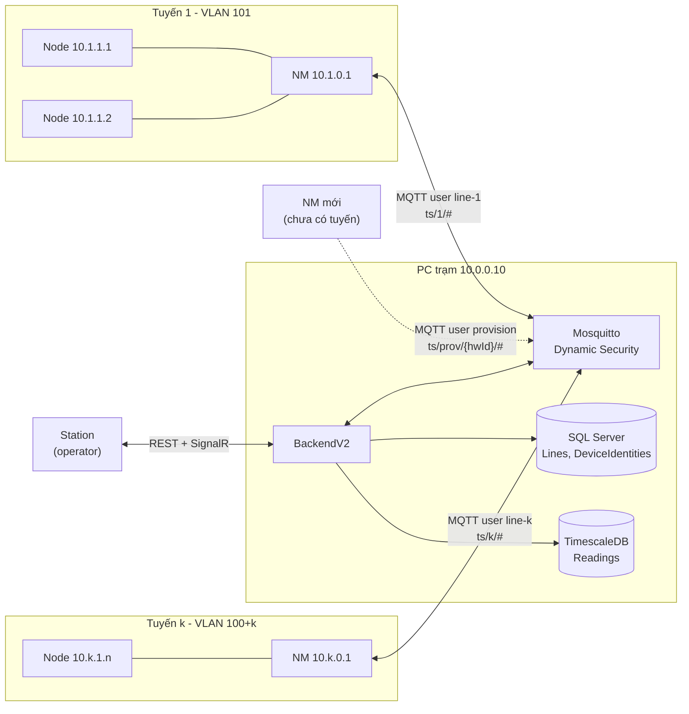
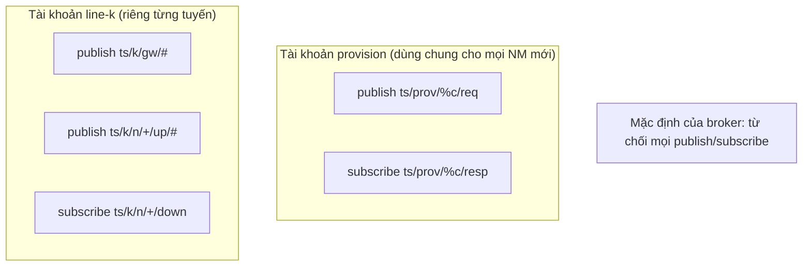
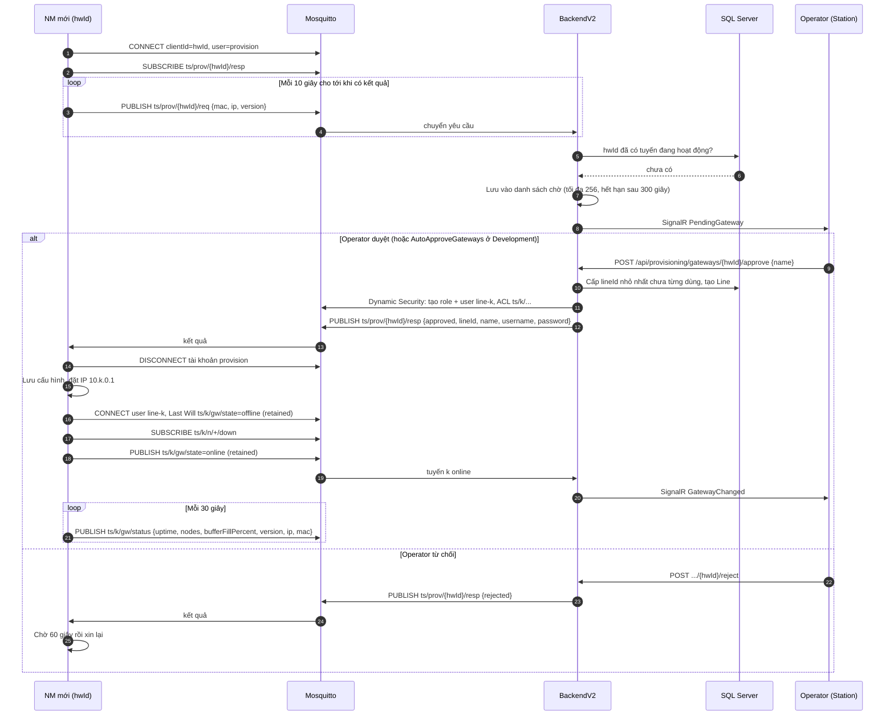
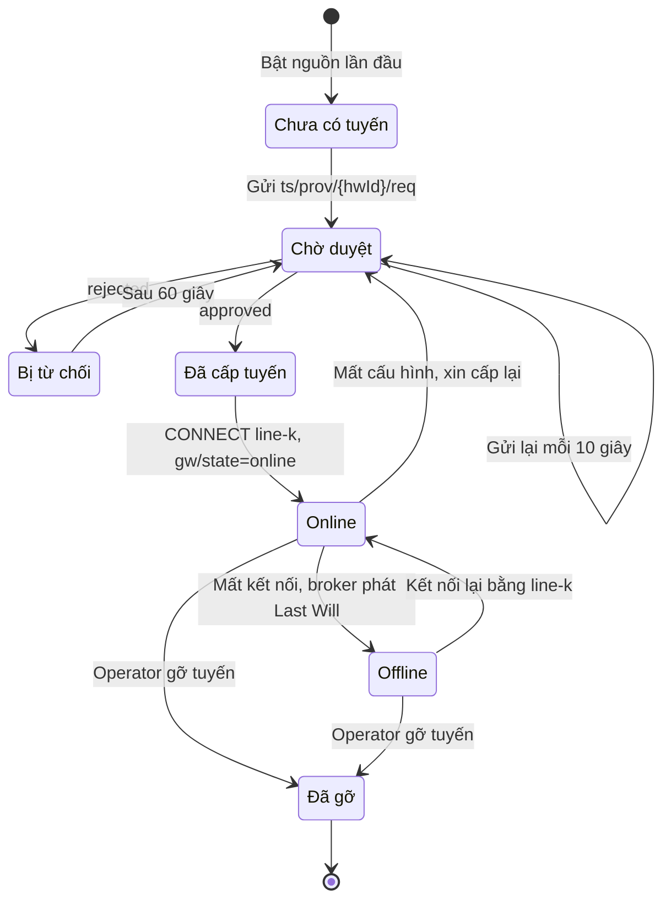
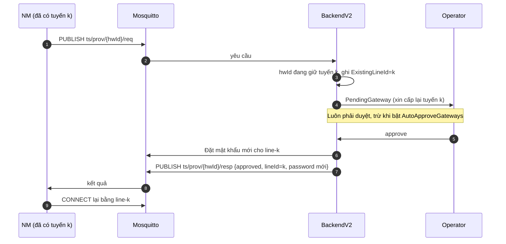
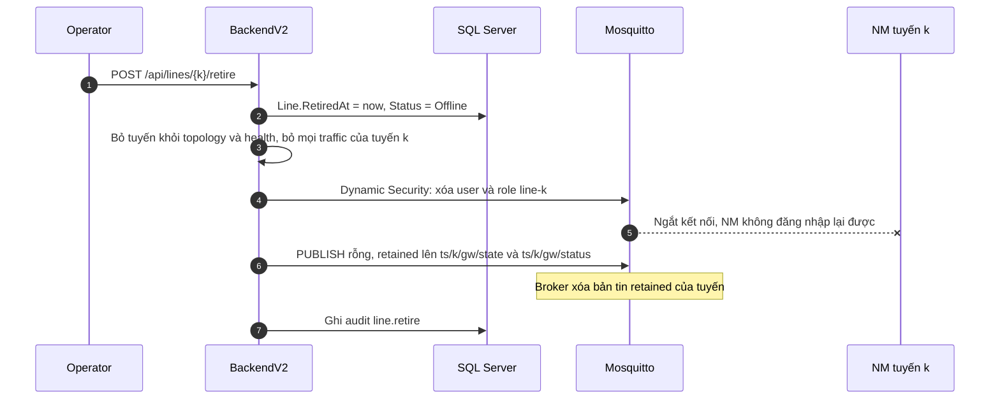
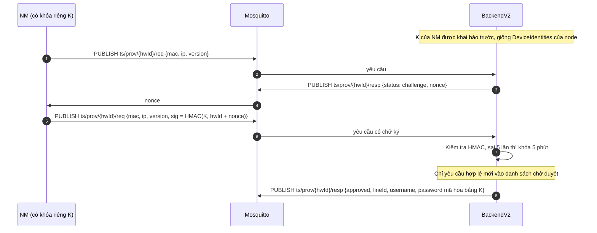

# Thiết kế cơ chế NM tham gia mạng (cấp tuyến)

Tài liệu này mô tả chi tiết cách một NM (Gateway tuyến) mới tham gia hệ thống, đánh giá điểm mạnh và điểm yếu của thiết kế hiện tại, và đề xuất hướng khắc phục.
Đây là phần mở rộng của mục 4.4 trong [lan-architecture-protocol.md](lan-architecture-protocol.md).
Phần node tham gia qua NM (A1, xác thực thách đố) chỉ được nhắc tới ở mức giao tiếp, chi tiết nằm ở mục 4.5 của tài liệu đó.

| Thành phần | Vị trí trong code |
|---|---|
| Cấp tuyến, duyệt, từ chối, gỡ tuyến | `BackendV2/Gateway/Provisioning/GatewayProvisioningService.cs` |
| Tài khoản và ACL trên broker | `BackendV2/Gateway/Mqtt/DynamicSecurityClient.cs` |
| Định tuyến bản tin theo topic | `BackendV2/Gateway/GatewayMessageRouter.cs` |
| Cây topic | `WireProtocol/GatewayTopics.cs` |
| API cho operator | `BackendV2/Controllers/ProvisioningController.cs`, `BackendV2/Controllers/LinesController.cs` |
| NM giả lập | `NodePublisherSim/SimulatedGateway.cs` |

---

## 1. Vị trí của NM trong hệ thống



NM là thiết bị duy nhất của một tuyến nói chuyện trực tiếp với broker.
Node phía sau NM không có tài khoản MQTT, mọi bản tin của node đi qua kết nối của NM.
Mỗi tuyến có một số hiệu `lineId` (1..254), một dải địa chỉ `10.k.0.0/16`, một VLAN và một tài khoản MQTT riêng.
Số tuyến không cố định, tuyến được thêm và gỡ khi hệ thống đang chạy.

---

## 2. Danh tính và quyền của NM

### 2.1 Danh tính

| Định danh | Ai đặt | Dùng để làm gì |
|---|---|---|
| `hwId` | Nhà sản xuất, ghi cố định trên NM | Khóa chính của yêu cầu cấp tuyến, bắt buộc trùng MQTT client id |
| `lineId` | PC cấp khi duyệt | Tiền tố topic `ts/{lineId}`, dải IP, VLAN |
| `line-{k}` + mật khẩu | PC sinh ngẫu nhiên 24 byte | Đăng nhập broker khi hoạt động |

`hwId`, MAC, IP và phiên bản đều do NM tự khai trong yêu cầu, PC không kiểm chứng được (xem điểm yếu Y1).

### 2.2 Hai loại tài khoản MQTT



`%c` là client id của kết nối, nên NM có client id `sim-gw-1` chỉ gửi được `ts/prov/sim-gw-1/req` và chỉ đọc được `ts/prov/sim-gw-1/resp`.
NM của tuyến k không thể gửi dữ liệu giả cho tuyến khác, cũng không đọc được lệnh của tuyến khác.
BackendV2 kiểm tra và đặt lại ACL mặc định "từ chối" mỗi lần khởi động, không phụ thuộc mặc định của phiên bản Mosquitto.

---

## 3. Luồng cấp tuyến cho NM mới

### 3.1 Sơ đồ tuần tự



### 3.2 Định dạng bản tin

Yêu cầu `ts/prov/{hwId}/req`, JSON, QoS 1, mọi trường tùy chọn:

```json
{ "mac": "02:51:00:00:00:09", "ip": "10.9.0.1", "version": "1.0.0" }
```

Kết quả `ts/prov/{hwId}/resp`, JSON, QoS 1:

```json
{ "status": "approved", "lineId": 4, "name": "Tuyến Đông", "username": "line-4", "password": "<ngẫu nhiên 24 byte>" }
```

`status` là `approved` hoặc `rejected`.
`username` và `password` chỉ có khi bật Dynamic Security.

Trạng thái NM `ts/{k}/gw/state`, chuỗi `online` hoặc `offline`, QoS 1, retained.
Thông tin NM `ts/{k}/gw/status`, JSON nhỏ, QoS 1, retained.

### 3.3 Quy tắc cấp số tuyến

- PC cấp số nhỏ nhất trong 1..254 chưa từng xuất hiện trong bảng `Lines`.
- Số của tuyến đã gỡ không được cấp lại, để dữ liệu lịch sử của tuyến cũ không bị lẫn với tuyến mới.
- Khi đã dùng hết 254 số, việc duyệt thất bại và cần tách sang một trạm khác.
- Mục 4.4 của tài liệu kiến trúc ghi "nhỏ nhất còn trống", cách viết đó chưa khớp với code và cần sửa thành "nhỏ nhất chưa từng dùng".

---

## 4. Vòng đời của NM



### 4.1 NM mất kết nối

- NM giữ keep-alive MQTT 15 giây.
- Khi kết nối đứt mà không ngắt sạch, broker phát Last Will `offline` lên `ts/{k}/gw/state`.
- PC đánh dấu NM offline, còn các node của tuyến chuyển sang "không xác định" chứ không phải "offline", vì node có thể vẫn chạy.
- Khi NM tắt chủ động, nó tự publish `offline` trước khi ngắt, vì ngắt sạch không kích hoạt Last Will.
- Kết quả đo ngày 2026-10-15 với 3 NM x 5 node: kill -9 NM thì PC phát hiện trong 2 giây, chạy lại thì đủ 15 node online sau 4 giây.

### 4.2 NM xin cấp lại



Cấp lại dùng đúng tuyến cũ nên dữ liệu và cấu hình node của tuyến được giữ nguyên.
Yêu cầu cấp lại không bao giờ tự đổi mật khẩu của tuyến đang chạy.
Lý do là tài khoản `provision` dùng chung, ai biết mật khẩu chung cũng có thể giả `hwId` của một NM đang hoạt động.

### 4.3 Gỡ tuyến



Dữ liệu lịch sử của tuyến được giữ lại.
Thao tác gỡ gọi lại được nhiều lần, để hoàn tất việc thu hồi nếu lần trước broker gặp lỗi.
Bước xóa bản tin retained được thêm ngày 2026-10-15.
Trước đó broker giữ bản tin của tuyến đã gỡ mãi, và mỗi lần backend khởi động đều báo "Ignoring traffic from line k which is not provisioned".

---

## 5. Điểm mạnh

| # | Điểm mạnh | Giải thích |
|---|---|---|
| M1 | Không cần cấu hình tay | NM mới cắm vào là tự xin tuyến, không phải sửa file cấu hình broker hay khởi động lại dịch vụ. |
| M2 | Mở rộng khi đang chạy | Dynamic Security tạo tài khoản và ACL lúc chạy, nên thêm hay gỡ tuyến không làm gián đoạn các tuyến khác. |
| M3 | Cô lập giữa các tuyến | Mỗi tuyến một tài khoản, ACL chỉ cho cây `ts/k/...`, một NM bị chiếm quyền không giả mạo được dữ liệu tuyến khác. |
| M4 | Quyền tối thiểu khi chưa được duyệt | Tài khoản `provision` chỉ gửi được yêu cầu và đọc kết quả của chính client id đó, không đọc được dữ liệu hay lệnh nào. |
| M5 | Có người duyệt | Thiết bị lạ không tự vào mạng được, operator thấy MAC, IP, phiên bản trước khi duyệt; thao tác có audit log. |
| M6 | Chống chiếm tuyến đang chạy | Yêu cầu cấp lại cho tuyến đã có luôn phải duyệt, không tự đổi mật khẩu của NM đang hoạt động. |
| M7 | Bền với hàng đợi | Mỗi NM chỉ giữ một yêu cầu mới nhất, danh sách chờ có giới hạn 256 và hết hạn sau 300 giây, NM gửi liên tục không làm đầy bộ nhớ. |
| M8 | Không chặn luồng dữ liệu | Cấp tuyến chạy trên worker riêng, vài lượt hỏi đáp với broker không làm chậm ingest của các tuyến đang chạy. |
| M9 | Phát hiện mất NM nhanh | Last Will retained cho biết NM mất kết nối trong vài giây, và người mới subscribe cũng thấy ngay trạng thái hiện tại. |
| M10 | Số tuyến không tái sử dụng | Lịch sử của tuyến đã gỡ không bao giờ lẫn với tuyến mới. |
| M11 | Địa chỉ suy ra được | IP `10.k.0.1` và `10.k.1.n` suy trực tiếp từ `(lineId, nodeId)`, không cần bảng tra. |
| M12 | Thu hồi có hiệu lực ngay | Xóa user trên broker ngắt NM ngay lập tức và xóa luôn trạng thái retained. |

---

## 6. Điểm yếu và đề xuất

| # | Điểm yếu | Mức độ | Hậu quả | Đề xuất |
|---|---|---|---|---|
| Y1 | NM không được xác thực bằng phần cứng | Cao | Chỉ dựa vào mật khẩu `provision` dùng chung và mắt operator. `hwId`, MAC do NM tự khai. Lộ mật khẩu chung thì kẻ tấn công gửi được yêu cầu giả trông như NM thật. | Cho NM dùng cơ chế giống node: khóa riêng khai báo trước và thách đố HMAC trong yêu cầu cấp tuyến. Tốt hơn nữa là chứng chỉ client TLS (mTLS) riêng cho từng NM. |
| Y2 | Chưa có thiết kế bootstrap IP và VLAN | Cao | NM chỉ biết IP `10.k.0.1` và VLAN `100+k` sau khi có `k`. Tài liệu chưa nói trước đó NM ở mạng nào và cổng switch chuyển VLAN bằng cách nào. | Thêm một VLAN cấp phát riêng có DHCP, chỉ mở tới cổng MQTT của broker. Sau khi duyệt, chuyển cổng switch sang VLAN tuyến, bằng tay hoặc tự động qua SNMP/NETCONF. |
| Y3 | Mật khẩu tuyến gửi qua MQTT | Trung bình | Nếu chạy 1883 không mã hóa (như môi trường dev), ai nghe được LAN đều đọc được mật khẩu `line-k`. | Bắt buộc TLS 8883 ngoài Development, BackendV2 từ chối khởi động nếu broker không dùng TLS. Khi có Y1, có thể mã hóa mật khẩu bằng khóa riêng của NM. |
| Y4 | Mật khẩu `provision` dùng chung | Trung bình | Một thiết bị bị lộ là lộ cho cả hệ thống, đổi mật khẩu phải cập nhật mọi NM chưa cấp tuyến. | Khi có Y1, tài khoản `provision` chỉ còn là kênh vận chuyển, an toàn dựa vào khóa riêng của từng NM. |
| Y5 | Chưa giới hạn tần suất yêu cầu | Thấp | NM lỗi hoặc kẻ tấn công đổi client id liên tục có thể đẩy danh sách chờ tới 256 mục, làm trôi yêu cầu thật. | Giới hạn tần suất theo client id và cảnh báo cho operator khi danh sách chờ tăng bất thường. |
| Y6 | Danh sách chờ chỉ nằm trong bộ nhớ | Thấp | Backend khởi động lại thì mất danh sách chờ. NM vẫn gửi lại mỗi 10 giây nên tự phục hồi, nhưng operator thấy yêu cầu biến mất một lúc. | Chấp nhận được. Nếu cần, lưu danh sách chờ vào DB. |
| Y7 | Phụ thuộc Mosquitto Dynamic Security | Thấp | Đổi broker (EMQX, HiveMQ) phải viết lại phần quản lý tài khoản. Mosquitto 2.1 còn có lỗi khi gán lại role đã có. | Giữ `DynamicSecurityClient` là lớp riêng biệt để thay được, đã làm như vậy. |
| Y8 | Một broker cho cả trạm | Thấp | Broker chết thì mọi tuyến mất kết nối cùng lúc. | Phù hợp quy mô hiện tại (đã thử 900 node). Khi cần, chạy cụm broker và dùng shared subscription (đã có tùy chọn `SharedSubscriptionGroup`). |
| Y9 | Tài liệu kiến trúc lệch code | Thấp | Mục 4.4 ghi "nhỏ nhất còn trống" trong khi code cấp "nhỏ nhất chưa từng dùng". | Sửa câu trong tài liệu kiến trúc. |

### 6.1 Thứ tự ưu tiên đề xuất

1. Y2: thiết kế bootstrap mạng, vì thiếu phần này thì NM thật không triển khai được.
2. Y1 và Y4: xác thực NM bằng khóa riêng, giải quyết cùng lúc vấn đề mật khẩu dùng chung.
3. Y3: bắt buộc TLS ngoài môi trường phát triển.
4. Y5, Y9: việc nhỏ, làm kèm.

### 6.2 Phác thảo luồng cấp tuyến có xác thực (đề xuất cho Y1)



Thiết kế này dùng lại `JoinProtocol` đang có cho node, nên NM và node chung một mô hình xác thực, và operator chỉ còn phải duyệt những thiết bị đã chứng minh được danh tính.
